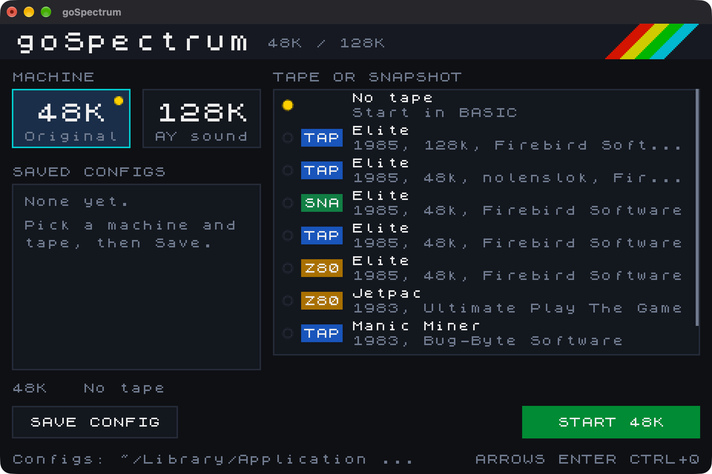
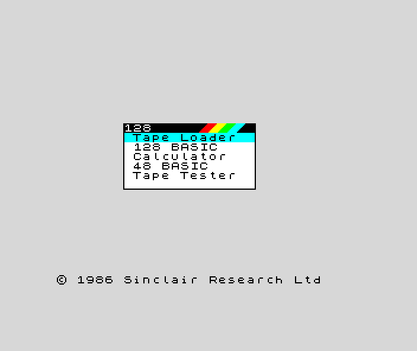
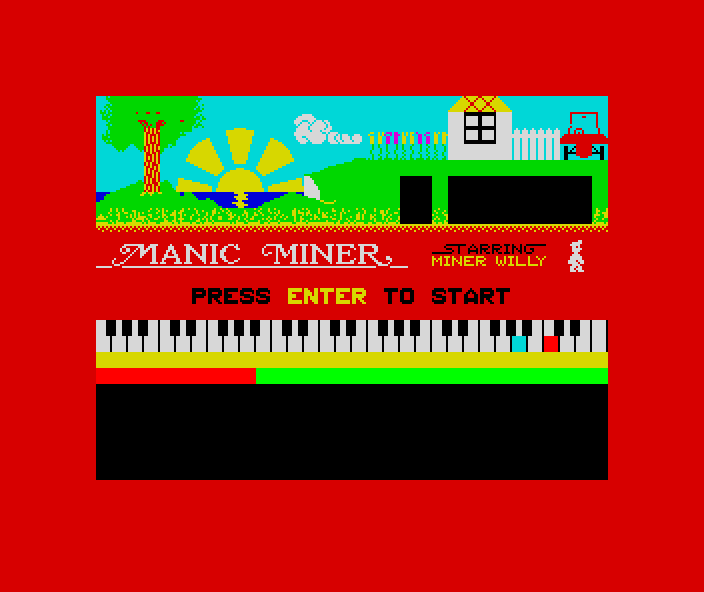
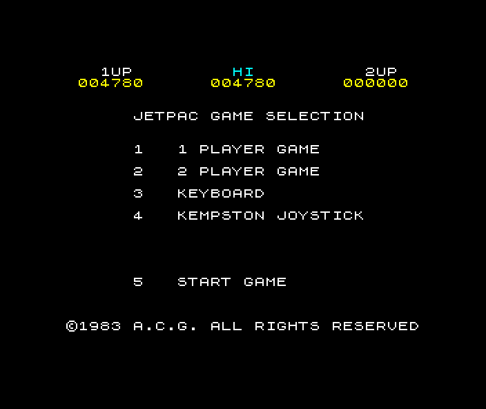
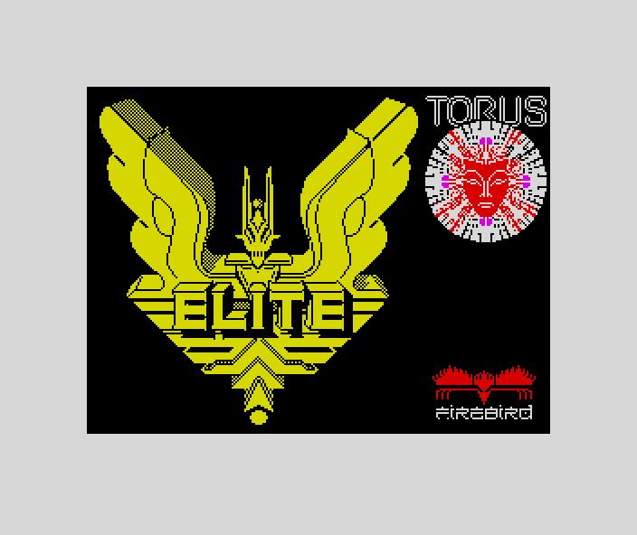

# goSpectrum

A ZX Spectrum 48K and 128K emulator written in Go, using [Ebitengine](https://ebitengine.org) for the window and audio.



## Features

- Z80 CPU, ULA with memory contention, border and beeper
- 128K paging and AY-3-8912 sound
- Loads `.tap` and `.tzx` tapes, and `.sna` and `.z80` snapshots
- Tapes autoload (`LOAD ""` is typed for you) and play in turbo, or at real speed with `--realtime-tape`
- A chooser for picking a machine and a program, with saved configs

## Screenshots

| | |
|---|---|
|  |  |
| 48K power-on | 128K menu |
|  |  |
| Manic Miner (`.tap`) | Jetpac (`.z80`) |
|  | |
| Elite (`.z80`) | |

## Requirements

- Go 1.25 or newer
- On Linux, the usual Ebitengine dependencies (X11/OpenGL and ALSA or PulseAudio development headers)
- Sinclair ROM images, which are not included in this repo

## ROMs

Put the ROMs in a `rom/` directory next to the executable or in the working directory:

| Model | File | Size |
|---|---|---|
| 48K | `rom/48.rom` | 16384 bytes |
| 128K | `rom/spec128uk.rom` or `rom/128.rom` | 32768 bytes |

Or pass one directly with `--rom <path>`.

## Build and run

```sh
go build -o spectrum ./cmd/spectrum
./spectrum
```

With no arguments the chooser opens. It lists tapes and snapshots in the working directory and in `Games/`, and can browse for a file elsewhere on macOS.

To start a program directly:

```sh
./spectrum "Games/Manic Miner (1983)(Bug-Byte Software).Tap"
./spectrum --model 128 game.tzx
```

A 128K snapshot switches to the 128K machine unless `--model 48` is given.

### Options

```
--model 48|128     machine. Direct start defaults to 48
--rom <path>       16384-byte 48K ROM, or 32768-byte 128K ROM
--config <name>    saved chooser config, or a path to one
--scale <N>        integer window scale, default 2
--sound <bool>     beeper and AY audio, default true
--realtime-tape    play the tape at wall-clock speed
--no-autoload      arm a tape without typing LOAD ""
-h, --help         show this help
--version          print the version
```

Configs saved from the chooser are JSON files in your user config directory under `goSpectrum` (`~/Library/Application Support/goSpectrum` on macOS).

## Keys

| Host | Spectrum |
|---|---|
| Letters, digits, Enter, Space | Same keys |
| Left Shift | Caps Shift |
| Right Shift, Alt | Symbol Shift |
| Arrow keys | Caps Shift + 5/6/7/8 |
| Backspace | Caps Shift + 0 (Delete) |
| F1 | Pause / resume |
| Ctrl+Q | Quit |

In the chooser, use the arrow keys or the mouse to pick, and Enter to start.

## Tests

```sh
go test ./...
```

## Layout

```
cmd/spectrum       command line, chooser, and window loop
internal/z80       Z80 CPU
internal/machine   memory, ULA, keyboard, tape, AY, 48K/128K models
internal/formats   TAP, TZX, SNA and Z80 readers
internal/timing    frame clock
internal/ui        drawing, audio, input, chooser font
internal/config    saved chooser configs
```
